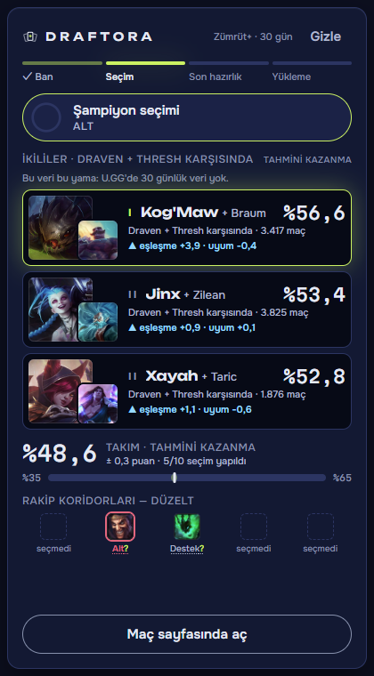
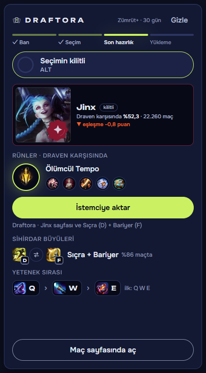
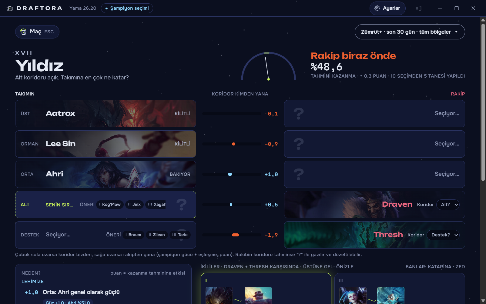

# Draftora

**League of Legends şampiyon seçimi için Windows uygulaması.** Seçim ekranının yanında küçük bir pencere açar: rolüne
göre en iyi seçimleri, koridor rakibine karşı kaç maçta ne kazandıklarını ve takımının kazanma tahminini gösterir.
Ücretsiz. Seçimi her zaman sen yaparsın.

**[⤓ Windows için indir](https://bcangrg.github.io/draftora-releases/)** ·
**[Yol haritası](https://bcangrg.github.io/draftora-releases/yol-haritasi.html)** (her sürümde ne geldi, sırada ne var)

  

## Ne yapar?

- **Şampiyon seçiminde, LoL istemcisinin yanında:** rolüne göre en iyi üç seçim, sağda takımının bu seçimle tahmini
  kazanma oranı. Koridor rakibin belli olunca ona karşı kaç maçta ne kazandığını da yazar.
- **Alt koridor ve destek için ikililer:** birbirinden farklı üç ikili. Rakip alt koridor belli değilse birlikte iyi
  oynayan ve takımına uyanlar, belli olunca onlara karşı güçlü olanlar. Senin ve partnerinin ekranında aynı ikililer
  görünür.
- **Banlar:** oynadığın koridor için en tehlikeli şampiyonlar.
- **Takımın tahmini kazanma oranı:** iki takımın seçtikleriyle; aynı draftta bütün takım arkadaşlarında aynı sayı.
- **Son hazırlık:** eşleşmeye göre rün sayfası, sihirdar büyüleri (Sıçra hangi tuştaysa orada) ve yetenek sırası; tek
  tıkla istemciye aktarılır.
- **Yükleme ekranında:** koridorun için kısa bir oyun planı; oyun başlayınca kapanır.
- **Ana pencerede:** güç sıralaması, karşı seçim, kör seçim, banlar, takım dizilimi, bot ikilileri, rünler ve eşyalar.

Her öneri birkaç seçenek, kazanma oranı ve maç sayısıyla gelir; tek bir "bunu seç" yoktur. Draftora seçim, ban, kilit,
maç kabulü gibi kararların hiçbirini senin yerine vermez ve diğer oyuncuların adlarını ya da derecelerini okumaz.

## Kurulum

1. [İndirme sayfasından](https://bcangrg.github.io/draftora-releases/) `Draftora-kurulum.exe` dosyasını indir ve çift
   tıkla. Windows 10 ve 11, yönetici izni gerekmez.
2. Windows "bilgisayarınızı korudu" derse **Ek bilgi**, sonra **Yine de çalıştır**. Draftora'nın ücretli bir dijital
   imzası olmadığı için bu yalnızca ilk kurulumda sorulur.
3. Draftora açılır. LoL istemcisini aç; şampiyon seçimine girince overlay kendiliğinden gelir.

Yeni sürümler kendiliğinden iner ve bir sonraki açılışta ya da Draftora kapanırken kurulur; LoL'de maçtayken kurulmaz.

## Ekranlar

| Şampiyon seçimi | Son hazırlık | Ana pencere |
| :---: | :---: | :---: |
|  |  |  |

Görüntüler gerçek uygulamadan, gerçek veriyle (Zümrüt+, son 30 gün); oyuncu adları hiç gösterilmez.

## Veri ve gizlilik

- İstatistikler [Lolalytics](https://lolalytics.com) ve [U.GG](https://u.gg)'den, şampiyon ve rün bilgileri Riot'un
  Data Dragon ve CommunityDragon verilerinden gelir. Ana penceredeki lig ve süre (ör. Zümrüt+ · 30 gün) sayıların
  hangi maçlardan geldiğini söyler.
- Hata olursa (Ayarlar'dan kapatılabilir) ya da Ayarlar › Sorun bildir ile gönderirsen kısa bir rapor gelir; oyuncu
  adı, hesap bilgisi ya da Windows kullanıcı adı gönderilmez.

Bu depo yalnızca Draftora'nın kurulum dosyalarını, güncelleme bilgisini (`latest.json`), indirme sayfasını ve yol
haritasını taşır.

Draftora, Riot Games tarafından onaylanmamıştır ve Riot Games'in ya da Riot Games mülklerinin yapımında veya
yönetiminde resmî olarak yer alan kimsenin görüşlerini yansıtmaz. League of Legends, Riot Games, Inc.'in ticari
markasıdır.
